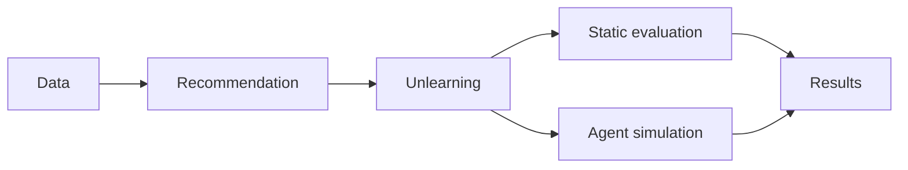

# AfterRec

**A research workbench for recommendation unlearning and user-agent evaluation.**

[简体中文](README.zh-CN.md) · [Architecture](docs/architecture/OVERVIEW.md) · [Documentation](docs/README.md) · [Roadmap](docs/ROADMAP.md)

What does a recommendation system show users after it has been asked to forget part of their history?

AfterRec is being developed to study that question from two perspectives. **Technical unlearning** examines the model after data deletion. **User-perceived forgetting** looks at recommendations shown during subsequent interactions. The two measurements can tell different stories, and AfterRec makes it possible to study them together.

For example, after removing past interactions with basketball products, a user might still see basketball-related items. Their appearance is worth measuring, but it does not by itself prove that the unlearning algorithm failed.

## What the platform aims to provide

- **Recommendation experiments:** manage datasets, train models and generate recommendations through a common interface.
- **Unlearning comparisons:** run forget requests and compare Original, Retrain and Unlearned model variants.
- **Two evaluation paths:** measure recommendation/forgetting metrics and simulate multi-turn user interactions.
- **Traceable results:** inspect model comparisons and user-agent trajectories with reproducible experiment settings.

## Workflow



A web workspace is planned to configure and inspect this workflow. The architecture supports different recommendation models, unlearning methods and agent policies behind shared interfaces.

## Current status

**Early development.** The repository contains an API scaffold, dataset validators, reference ranking metrics, a minimal simulation runner and an offline interactive prototype. The HTML prototype uses mock data. Real model training, end-to-end unlearning experiments and human-validated agent evaluation are still being integrated.

### Try the current foundation

Python 3.10+ is required. From the repository root:

```bash
python -m pip install -e '.[dev]'
python -m pytest -q
python -m uvicorn recforgetbench.api.main:app --reload --port 8000
```

Open `http://127.0.0.1:8000/docs` to inspect available APIs, or open `frontend/index.html` directly to explore the offline concept demo. Demo metrics and trajectories are synthetic.

## Learn more

The [architecture overview](docs/architecture/OVERVIEW.md) explains the system layout. [Documentation](docs/README.md) links to the module designs, shared interfaces and research protocol. See the [roadmap](docs/ROADMAP.md) for implementation progress and [contributing guide](CONTRIBUTING.md) for proposed changes.

## License and data

This repository has no software license yet. Public access does not automatically permit redistribution or reuse. External code and datasets, if incorporated, must follow their own attribution and licensing requirements.
