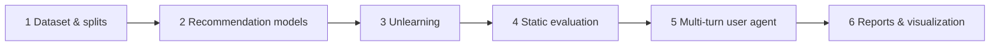
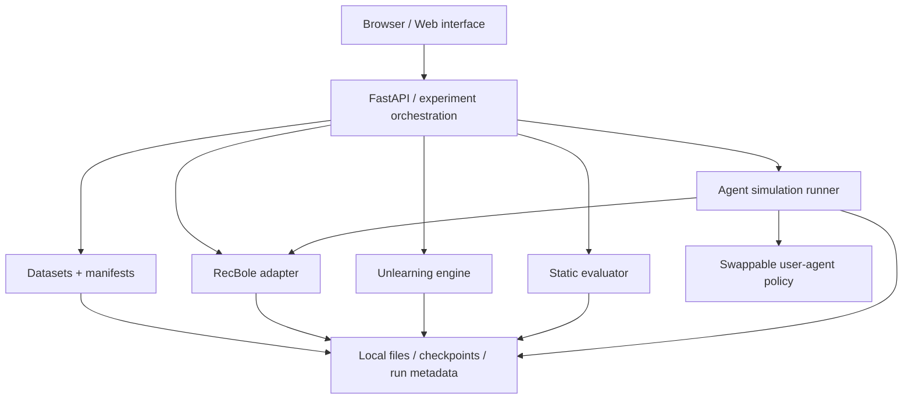

# RecForgetBench

**A modular benchmarking platform for recommendation unlearning and user-agent evaluation.**

[简体中文](README.zh-CN.md) · [Architecture](docs/architecture/OVERVIEW.md) · [Roadmap](docs/ROADMAP.md) · [Contributing](CONTRIBUTING.md)

> **Status: pre-MVP / repository foundation.** The interactive HTML screen is a
> **synthetic concept demo**, not a working unlearning benchmark. No empirical
> results, training runs, or validated human-behavior simulations are claimed.

## Why RecForgetBench?

Machine unlearning in recommender systems is often evaluated using recommendation
quality, forgetting-set behavior, privacy attacks, and runtime. These metrics
do not necessarily describe what users *experience* after requesting deletion.
For example, removing basketball-related interactions does not guarantee that
recommendations will no longer surface related concepts or products.

**RecForgetBench asks two distinct questions:**

1. **Technical data unlearning:** How does an unlearned recommender compare to a
   model freshly retrained on retained training data?
2. **User-perceived forgetting:** What related recommendations are users still
   exposed to during interaction, and can a calibrated user simulator reliably
   assess that exposure?

Residual exposure is **not**, by itself, proof that technical unlearning failed.
The platform is designed to report the two dimensions separately and examine
where they align or diverge.

## Vision and modules



| Module | Responsibility | Planned integrations | Owner |
| --- | --- | --- | --- |
| Dataset Management | Import interactions, item metadata, train/valid/test and forget/retain manifests | Amazon e-commerce data | Student A |
| Recommendation | Train, persist and serve model scores/Top-K via adapters | RecBole, BPR-MF, LightGCN | Student A |
| Unlearning | Execute and track forget requests; compare against a fresh retrain baseline | Retrain first; other compatible methods later | Student B |
| Static Evaluation | Utility, forgetting diagnostics, privacy and efficiency | Recall@K, NDCG@K, later MIA | Student B |
| Agent Simulation | Persona, intent, controlled multi-turn feedback and trajectories | Rule-based runtime first, research LLM agent later | Student C + Research Lead |
| Web & Experiments | Configure experiments, view statuses, inspect outputs and traces | FastAPI + planned React frontend | Student C |

**Research Lead:** sets scientific questions, experimental protocols, agent-method
research and milestone acceptance; the students own everyday implementation,
verification and integration.

## Architecture

RecForgetBench starts as a **modular monolith** (one Python service, separately
owned packages, one Git repository), not a distributed microservice platform.



**Not all arrows are implemented yet.** Read the [architecture](docs/architecture/OVERVIEW.md)
and [cross-module contracts](docs/contracts/INTERFACES.md) before coding.

## What works today?

| Area | Current state |
| --- | --- |
| Offline visual walkthrough | **Available**: `frontend/index.html`; all values/actions are illustrative |
| Python package and FastAPI startup | **Available**: health and capabilities routes |
| Scientific data split validators | **Available**: small, tested invariants |
| Example ranking-metric functions | **Available**: standalone tested reference functions, not an end-to-end evaluation pipeline |
| Simulation action schema and small runner | **Available**: contract/runtime scaffold, only toy test fixtures |
| RecBole training and recommendation | **Not implemented** |
| Retrain / approximate unlearning | **Not implemented** |
| Real dataset ingestion, Web jobs and real metrics | **Not implemented** |
| Calibrated LLM user simulation | **Research work, not implemented** |

## Quick start (foundation only)

**Requirements:** Python 3.10+ and a modern browser. Python 3.11 is used in
CI; Student A will separately validate and document a reproducible RecBole / PyTorch
environment. A GPU is **not** required for the foundation tests.

```bash
# At the repository root, create and activate a virtual environment first.
python -m pip install -e '.[dev]'
python -m pytest -q
python scripts/verify_scaffold.py
python scripts/check_frontend.py

# Start the actual (currently minimal) API:
python -m uvicorn recforgetbench.api.main:app --reload --port 8000
```

Then visit:

- <http://127.0.0.1:8000/docs> — OpenAPI documentation.
- <http://127.0.0.1:8000/api/v1/health> — verified API liveness.
- <http://127.0.0.1:8000/api/v1/capabilities> — implementation status.

Open **`frontend/index.html`** directly in a browser to explore the static
interactive product prototype. It works without an API, dataset, LLM or GPU.
**Do not use its example metrics as evidence for a paper.**

## Repository map

```text
.
├── AGENTS.md                 # Coding agent / Codex rules
├── CLAUDE.md                 # Claude Code entry point (shares root rules)
├── backend/src/recforgetbench/
│   ├── core/                 # Shared, versioned types and invariants
│   ├── datasets/             # Student A
│   ├── recsys/               # Student A: RecBole adapter and train/recommend
│   ├── unlearning/           # Student B
│   ├── evaluation/           # Student B
│   ├── simulation/           # Student C + research decisions from Lead
│   └── api/                  # Student C: FastAPI
├── frontend/                 # Student C: offline product demo today
├── docs/                     # Architecture, contracts, simulation and team roles
├── tests/                    # Lightweight scientific and API tests
├── scripts/                  # Checks and local developer utilities
└── .github/                  # CI, Issues and PR templates
```

## Working together with Claude Code and Codex

- **One shared repo, three independent workspaces.** No simultaneous edits in
  the same working directory or shared `main` branch.
- **One Issue → one short feature branch → one focused Pull Request.**
- **Module ownership is explicit.** Shared contracts need cross-owner agreement.
- Claude Code follows [`CLAUDE.md`](CLAUDE.md); Codex follows [`AGENTS.md`](AGENTS.md).
  Both use the same source of truth and nested module rules.
- **CI, agent code review, and independent student testing** are required; an
  AI reviewing its own generated tests is not sufficient for scientific validity.
- Student C coordinates integration. The Project Owner reviews observable
  milestones and scientific results, not every code diff.

See [team ownership](docs/team/OWNERSHIP.md), [initial tasks](docs/team/FIRST_ISSUES.md),
[GitHub setup](docs/team/BOOTSTRAP_GITHUB.md), and [contributing](CONTRIBUTING.md).

## Scientific safeguards

- Forget/Retain are a disjoint partition of **Train**; validation/test stay held out.
- Original, fresh Retrain and approximate Unlearned are distinct model artifacts.
- Comparisons use the same item universe, ID mapping, candidate protocol and masks.
- Agents only see permitted observations, never hidden labels or future actions.
- The base recommender stays frozen during user simulation; per-session feedback
  is handled by a separate state/adapter with the same rules for all model arms.
- User-perceived association and technical unlearning are **separate** claims.

[Research simulation protocol](docs/research/SIMULATION_PROTOCOL.md)

## Roadmap

1. **P1:** real RecBole model + reproducible data + Top-K through API/Web.
2. **P2:** train-only forget selection, fresh Retrain, static comparison.
3. **P3:** feedback-driven 3–5 turn agent runtime and trajectory playback.
4. **Research:** calibrated LLM-agent metrics, human labels, more algorithms and datasets.

See [the milestone checklist](docs/ROADMAP.md).

## Attribution, data and licensing

RecBole and external datasets are **separate third-party projects**; their
software and data licenses must be checked independently. No datasets or model
weights are included in this repository scaffold. This repository currently
has **no open-source license**: do not assume reuse rights until the Project
Owner explicitly selects and adds one before public release.

## Project status

This repository was designed as a foundation for a student-led research
engineering team. Contributions should prioritize **real, reproducible behavior
and integration over broad lists of unfinished features**.
