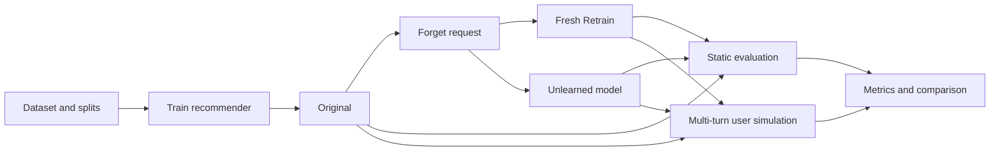

# AfterRec

**Recommendation unlearning, from model metrics to user experience.**

[简体中文](README.zh-CN.md) · [Architecture](docs/architecture/OVERVIEW.md) · [Roadmap](docs/ROADMAP.md) · [Contributing](CONTRIBUTING.md)

When a user asks a recommender system to forget part of their history, what changes in the recommendations they see afterward?

Most recommendation-unlearning studies evaluate model utility, forgetting behavior, privacy attacks or runtime. AfterRec brings these measurements together with **multi-turn user simulation**, so researchers can examine both model-level outcomes and the recommendations exposed to users during interaction.

For example, deleting a user's basketball-related interactions may change the model's scores, yet basketball-themed products could still appear later. Those recommendations alone do not establish whether data unlearning succeeded or failed. AfterRec is designed to study the two questions separately and compare the evidence.

> **Development status:** AfterRec is in the **pre-MVP stage**. The repository includes a working API scaffold, basic metric functions, a small simulation runtime and an interactive **mock-data prototype**. End-to-end training, unlearning and validated LLM-user evaluation are planned, not yet available.

## What AfterRec is building

- **Comparable unlearning experiments.** Train recommendation models, specify what to forget, and compare Original, fresh Retrain and Unlearned models under the same evaluation protocol.
- **Traditional evaluation.** Measure recommendation quality and forgetting behavior, with privacy and efficiency measures added as their protocols are implemented.
- **Multi-turn user evaluation.** Let a configurable user agent receive recommendations, respond to them, and produce a trace of what was shown and what happened next.
- **Inspect and reproduce results.** View model metrics alongside interaction trajectories, while retaining dataset splits, configurations and run provenance.

The initial scope is **e-commerce recommendation**, with RecBole-based models such as BPR-MF and LightGCN. The architecture allows additional models, unlearning methods and agent policies to be integrated later.

## How it fits together



The pipeline uses the same users, item universe and evaluation settings for each model comparison. Simulated user exposure is a separate research outcome; it is **not** a substitute for technical unlearning tests.

[Read the architecture](docs/architecture/OVERVIEW.md) for module boundaries and experimental safeguards.

## What you can run today

| Available now | Still in development |
| --- | --- |
| Local FastAPI service with health and capability endpoints | Real RecBole training and Top-K served through the application |
| Dataset-split validation and standalone Recall/NDCG reference functions | Retrain and other unlearning methods connected end to end |
| Minimal, tested simulation action/episode contracts | Agent rollouts on trained recommenders |
| Interactive HTML walkthrough with clearly labeled mock data | Experiment dashboard with measured results and trace replay |
| | Human-calibrated LLM user agents and perceived-forgetting metrics |

### Explore the prototype

Use Python 3.10+ and a modern browser. From the repository root:

```bash
python -m pip install -e '.[dev]'
python -m pytest -q
python -m uvicorn recforgetbench.api.main:app --reload --port 8000
```

Open [http://127.0.0.1:8000/docs](http://127.0.0.1:8000/docs) for the currently implemented API. You can also open `frontend/index.html` directly to explore the offline UI concept.

**The HTML demo uses synthetic products, scores and actions.** It does not run real model training, machine unlearning or an LLM.

## Documentation and next steps

- [Architecture overview](docs/architecture/OVERVIEW.md) ([中文](docs/architecture/OVERVIEW.zh-CN.md)): system design and experiment flow
- [Module interfaces](docs/contracts/INTERFACES.md): shared data types and proposed integration contracts
- [Simulation protocol](docs/research/SIMULATION_PROTOCOL.md): observation boundaries and research validity
- [Roadmap](docs/ROADMAP.md): implementation checklist
- [Contributing](CONTRIBUTING.md): how to report issues and propose changes

The near-term goal is a **local end-to-end experiment**: real recommendation outputs, a controlled forget request, retraining-based comparison, static metrics, and a short, explicitly synthetic user-agent rollout. Human alignment and new user-perceived metrics are later research steps.

## License and data

A software license has **not yet been added**. Public visibility does not grant permission to reuse or redistribute the code. RecBole and third-party datasets have their own licenses; no bulk datasets or trained model weights are bundled here.
