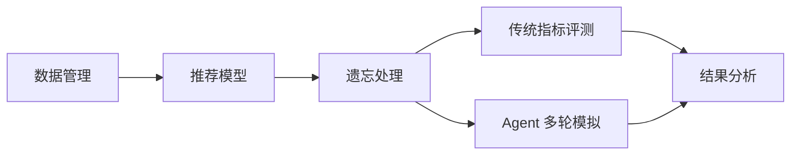

# AfterRec

**面向推荐系统遗忘与用户 Agent 评测的研究平台。**

[English](README.md) · [整体架构](docs/architecture/OVERVIEW.zh-CN.md) · [项目文档](docs/README.md) · [开发路线](docs/ROADMAP.md)

当推荐系统删除了用户的一段历史行为，用户之后看到的推荐会发生什么变化？

AfterRec 希望从两个角度研究这个问题：**技术遗忘**关注数据删除对推荐模型的影响，**用户感知遗忘**关注用户在后续交互中实际接触到的推荐内容。平台将两类结果放在同一实验中观察和比较。

例如，删除篮球商品的历史交互后，用户仍有可能看到篮球相关商品。这种曝光值得研究，但不能仅凭它断定遗忘算法失效。

## 平台计划提供的能力

- **推荐实验：** 统一管理数据集、模型训练与推荐结果。
- **遗忘对照：** 执行遗忘请求，对比 Original、Retrain、Unlearned 模型。
- **双轨评测：** 结合传统推荐与遗忘指标、Agent 多轮用户交互。
- **实验分析：** 对照模型结果和交互轨迹，保存可复现的实验配置。

## 整体流程



平台计划通过网页组织实验流程，各推荐模型、遗忘方法与 Agent 策略通过统一接口接入。

## 当前进度

**处于早期开发阶段。** 仓库已有 API 骨架、数据校验、基础排序指标、最小模拟运行器和离线交互原型。前端原型使用模拟数据；真实模型训练、端到端遗忘实验和经过人类验证的 Agent 评测仍在逐步接入。

### 体验当前基础版本

需要 Python 3.10+，在仓库根目录运行：

```bash
python -m pip install -e '.[dev]'
python -m pytest -q
python -m uvicorn recforgetbench.api.main:app --reload --port 8000
```

访问 `http://127.0.0.1:8000/docs` 查看现有 API，或直接打开 `frontend/index.html` 体验离线原型。演示中的指标与交互轨迹均为模拟结果。

## 进一步阅读

[整体架构](docs/architecture/OVERVIEW.zh-CN.md)介绍系统结构；[文档目录](docs/README.md)列出模块设计、接口协议与研究规范；[开发路线](docs/ROADMAP.md)记录进度，[贡献指南](CONTRIBUTING.md)说明协作方式。

## 许可证与数据

仓库尚未添加软件许可证。公开可见不等于自动授权复用或分发。若引入第三方代码或数据，仍需遵守其许可证及署名要求。
