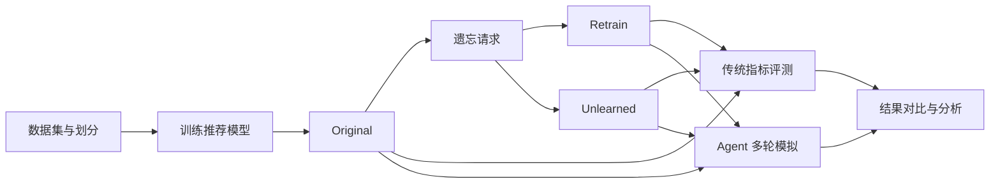

# AfterRec

**从模型遗忘指标，到用户实际看到的推荐。**

[English](README.md) · [整体架构](docs/architecture/OVERVIEW.zh-CN.md) · [开发路线](docs/ROADMAP.md) · [参与贡献](CONTRIBUTING.md)

当用户要求推荐系统删除某段历史行为后，后续推荐究竟发生了什么变化？

现有推荐遗忘研究通常关注推荐精度、遗忘效果、隐私攻击和运行效率。**AfterRec** 希望在这些传统评测之外，引入**多轮用户 Agent 模拟**，观察遗忘后的推荐结果如何在连续交互中呈现给用户。

例如，用户要求删除篮球商品的历史交互，模型的推荐分数可能已经改变，但在后续浏览中仍可能出现篮球主题商品。仅凭这种曝光，无法判断模型是否完成了技术层面的数据遗忘。AfterRec 将两类结果分开评估，再研究它们之间的关系。

> **当前状态：MVP 开发前期。** 仓库已包含基础 API、部分指标函数、最小模拟运行框架和可交互的**模拟数据原型**。真实模型训练、遗忘实验闭环以及经过验证的 LLM 用户评测仍在开发计划中。

## AfterRec 能做什么

- **统一对比遗忘方法：** 管理数据划分和遗忘请求，在相同协议下比较 Original、从头训练的 Retrain 与 Unlearned 模型。
- **传统指标评测：** 评估推荐质量与遗忘相关表现，并逐步接入隐私和效率指标。
- **多轮用户模拟：** Agent 根据展示的推荐结果执行点击、不感兴趣、跳过等行为，记录每轮曝光与反馈。
- **结果分析与复现：** 对照模型指标和交互轨迹，保存必要的实验配置、数据版本与运行记录。

第一版面向**电商推荐场景**，计划通过 RecBole 接入 BPR-MF、LightGCN 等模型；后续逐步支持更多推荐模型、遗忘算法和 Agent 策略。

## 整体流程



各实验组使用一致的用户、商品范围和评测设置。**用户感知遗忘是一条独立的研究维度**，不能代替技术遗忘验证。

更多细节见[整体架构设计](docs/architecture/OVERVIEW.zh-CN.md)。

## 当前可以体验什么

| 已提供 | 后续实现 |
| --- | --- |
| FastAPI 服务与健康检查、能力状态接口 | 真实 RecBole 训练和 Top-K 推荐 |
| 数据划分校验、独立可测的 Recall/NDCG 函数 | Retrain 与其他遗忘算法的完整实验 |
| 最小 Agent 动作协议与回合运行框架 | Agent 与真实推荐模型的连续交互 |
| 基于模拟数据的 HTML 交互原型 | 真实指标可视化和轨迹回放 |
| | 经过人类行为校准的 LLM Agent 与感知遗忘指标 |

### 体验当前原型

需要 Python 3.10+ 和现代浏览器。在仓库根目录运行：

```bash
python -m pip install -e '.[dev]'
python -m pytest -q
python -m uvicorn recforgetbench.api.main:app --reload --port 8000
```

访问 [http://127.0.0.1:8000/docs](http://127.0.0.1:8000/docs) 查看现有 API；直接打开 `frontend/index.html` 可以体验离线交互原型。

**前端展示的商品、分数和 Agent 行为均为模拟数据**，不代表真实训练、遗忘算法或 LLM 实验结果。

## 项目文档

- [整体架构设计](docs/architecture/OVERVIEW.zh-CN.md)（[English](docs/architecture/OVERVIEW.md)）：模块边界与端到端实验流程
- [公共接口](docs/contracts/INTERFACES.md)：数据结构和模块对接约定
- [Agent 模拟协议](docs/research/SIMULATION_PROTOCOL.md)：交互边界与科研有效性要求
- [开发路线](docs/ROADMAP.md)：阶段性功能清单
- [参与贡献](CONTRIBUTING.md)：Issue、代码提交与验证要求

近期目标是先跑通一次**本地、可复现的完整实验**：真实推荐模型、遗忘请求、Retrain 对照、静态指标，以及明确标注为模拟行为的短程 Agent 交互。更接近真实用户的 LLM Agent 和新评测指标会在此基础上继续研究。

## 许可证与数据

仓库**尚未添加软件许可证**。代码公开可见并不自动授予复用或再分发权利。RecBole 与外部数据集适用各自的许可证；本仓库不附带大型数据集或训练权重。
