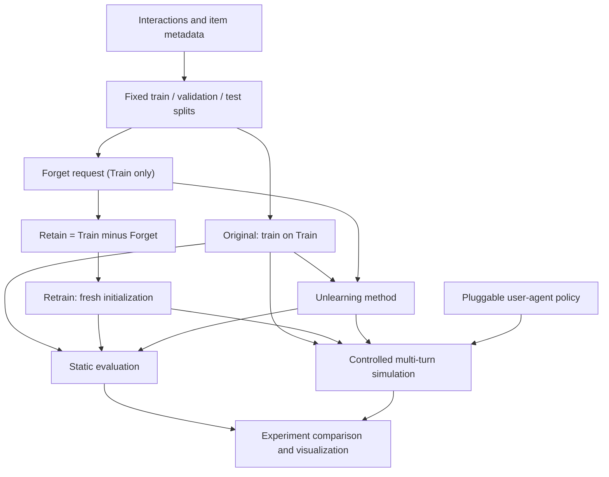

# AfterRec architecture

[简体中文](OVERVIEW.zh-CN.md) · [README](../../README.md) · [Interfaces](../contracts/INTERFACES.md) · [Simulation protocol](../research/SIMULATION_PROTOCOL.md)

AfterRec is designed as a **local-first modular research workbench**. A Python backend handles recommendation experiments and user simulation; a web interface configures runs and presents results. Independent model, unlearning and agent implementations connect through shared contracts.

This is the **target architecture**. The repository currently provides the foundations, not a complete end-to-end benchmark.

## Experiment flow



Original, Retrain and Unlearned are **separate model artifacts**. Retrain is a reference model trained from scratch on retained interactions; approximate unlearning methods start from the original model as required by their algorithms.

## Main components

| Module | Responsibility | Boundary |
| --- | --- | --- |
| `datasets` | Import interactions and item metadata; maintain versions, fixed splits and user/item mappings | Produces dataset and split manifests |
| `recsys` | Train/load recommender models and return scores or Top-K results through adapters such as RecBole | Exposes a model artifact and recommendation interface |
| `unlearning` | Define forget requests and produce Retrain/Unlearned artifacts | Consumes training splits and model artifacts |
| `evaluation` | Compute comparable utility and forgetting diagnostics | Receives fixed evaluation protocols and model artifacts |
| `simulation` | Run bounded agent interactions, validate actions and record exposure/feedback traces | Receives model recommendations and a swappable agent policy |
| `api` + `frontend` | Orchestrate experiments and display metrics, recommendations and trajectories | Use shared API contracts; no algorithm logic in routes |

Common types, validation and run metadata live in `core`. Experiment files and checkpoints are stored locally for the MVP. This **modular monolith** avoids distributed services while keeping model and agent implementations replaceable.

## Two evaluation paths

**Technical unlearning.** Compare recommendation utility and forgetting behavior for Original, Retrain and Unlearned using the same evaluation users, item candidates, ID mapping, masking and aggregation. Initial metrics include Recall@K and NDCG@K. MIA, privacy indicators and efficiency measures require explicit protocols before their results can be interpreted.

**User-perceived forgetting.** A simulated user receives a persona, its deletion intent, currently displayed items and its own past actions. It selects `click`, `dislike`, `skip` or `exit`. The runner records the ordered trajectory and applies session-local feedback. The recommender's trainable parameters remain frozen during an episode.

A semantic association observed in recommendations does **not** establish that technical unlearning failed. The platform compares user exposure and technical metrics as separate outcomes.

## Experimental safeguards

- **No data leakage:** Forget and Retain partition the original training set. Validation/test interactions, future actions and hidden labels stay outside training and agent observations.
- **Controlled comparisons:** Reset the agent and session state for each model arm. Use the same candidate protocol and feedback adapter across arms.
- **Traceable runs:** Save dataset/split versions, seeds, model and prompt versions, configuration, Git revision, metrics and trajectories.
- **Honest evidence:** Synthetic interactions remain labeled synthetic. Rating/review datasets are not assumed to contain real multi-turn browsing logs; human-like simulation needs independent validation.

See the [shared interfaces](../contracts/INTERFACES.md) for the current contracts and the [simulation protocol](../research/SIMULATION_PROTOCOL.md) for research details.

## Repository structure

```text
backend/src/recforgetbench/
  core/          Shared contracts and validation
  datasets/      Data ingestion and splits
  recsys/        Recommender adapters
  unlearning/    Unlearning methods and retraining
  evaluation/    Static evaluation
  simulation/    User-agent runtime
  api/           FastAPI service
frontend/        Web interface (currently an offline prototype)
docs/            Architecture, contracts and research protocols
tests/           Unit and integration tests
```

The existing Python import name is `recforgetbench`; **AfterRec** is the public project name.

## Implementation status

**Available:** API health/capability endpoints, core validators, standalone ranking-metric functions, a small simulation runner and an offline mock-data UI.

**Next:** real RecBole training and Top-K, reproducible Forget/Retain and fresh Retrain, static comparisons, then 3–5-turn simulations against trained models. Calibrated LLM agents, human studies and novel perceived-forgetting measures are longer-term research.

For the implementation checklist, see the [roadmap](../ROADMAP.md).
