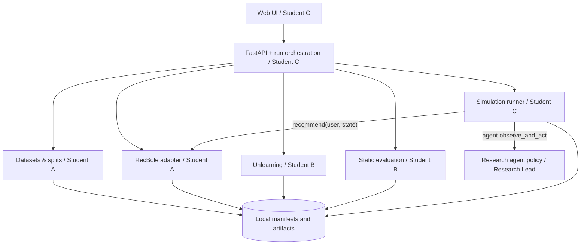
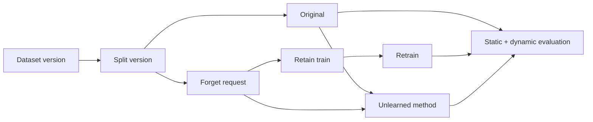

# Architecture overview

## Scope

A modular, locally runnable research workbench with a web interface and independent
recommendation, unlearning, evaluation and simulated-user engines. **Not microservices.**

The diagram is logical, not an indication that every component is implemented.

## Cross-module dependency rules

1. `datasets` produces versioned data and immutable ID mappings.
2. `recsys` trains and loads recommendation models, exposes scores and Top-K.
3. `unlearning` produces a *new* model artifact from a defined forget request.
4. `evaluation` reads common model artifacts and computes static metrics.
5. `simulation` requests recommendations, exposes them to a user policy, records
   actions and applies session-only feedback; it does not train the recommender.
6. `api` only validates requests and orchestrates background jobs and artifact access.
7. `frontend` consumes API responses, with `frontend/index.html` currently only
   an offline product-vision prototype.

## Run lineage

## Key architectural decisions

- **Single repo / Python package:** reduce integration cost with three developers.
- **Adapter for RecBole:** avoid copying framework internals into the repository.
- **Immutable experiment manifests:** make runs comparable and auditable.
- **Research Agent is a plugin:** allow the Research Lead to evolve algorithms
  independently from the simulation runner and Web UI.
- **No mandatory LLM calls:** tests and the initial scaffold work offline.
- **No fake completed tasks:** unimplemented capabilities remain marked planned.
- **Data-unlearning-only by default:** no hidden semantic preference filter.

See `docs/contracts/INTERFACES.md` and `docs/research/SIMULATION_PROTOCOL.md`.
