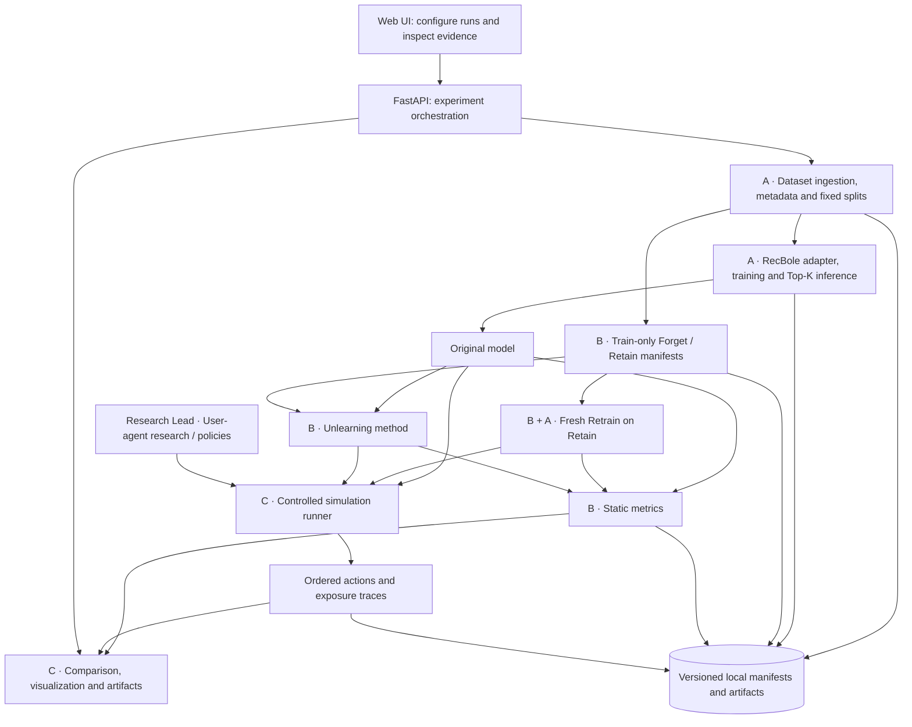

# AfterRec — Project Architecture Overview / 项目整体架构总览

[English](#english) · [简体中文](#简体中文) · [Interfaces](../contracts/INTERFACES.md) · [Simulation protocol](../research/SIMULATION_PROTOCOL.md) · [Roadmap](../ROADMAP.md) · [Team ownership](../team/OWNERSHIP.md)

> **Project status (November 2026): repository foundation / pre-MVP.** This document describes the **target architecture** and phased implementation plan, not a fully operational benchmark. The current frontend is a synthetic concept demo; real RecBole training, unlearning experiments and calibrated LLM-user evaluation are **not implemented**. The repository is named **AfterRec**, while its existing Python package is still `recforgetbench`; renaming code is out of scope.
>
> **当前状态（2026 年 11 月）：仓库骨架 / MVP 前期。** 本文描述的是**目标架构与分阶段实现计划**，并非宣称平台已经实现。现有前端仅为合成数据演示；真实 RecBole 训练、遗忘实验及经过校准的 LLM 用户评测**尚未实现**。项目名称为 **AfterRec**，现有 Python 包名仍为 `recforgetbench`，本次文档更新不涉及代码重命名。

---

<a id="english"></a>
## English

### 1. Purpose and research questions

**AfterRec** is a locally runnable, reproducible research platform for evaluating **recommendation unlearning** from two complementary perspectives:

1. **Technical unlearning:** Does the post-deletion model behave like a model retrained from scratch without the forgotten training interactions?
2. **User-perceived forgetting:** During multi-turn recommendation exposure and feedback, does a user still encounter content associated with their deletion intent—and how reliably can a simulated user capture that experience?

These questions are related but **not equivalent**. Semantically related recommendations after deletion are not, on their own, evidence of failed machine unlearning. The benchmark reports technical and perceptual outcomes **separately**, then investigates agreement, divergence and potential causes.

**Initial scope:** an e-commerce recommendation scenario, local deployment, modest models and a complete experimental loop. Broader datasets, methods, user studies and deployment come later.

### 2. End-to-end experimental architecture



The diagram specifies **logical dependencies**, not completed features. In a run, Original, fresh Retrain and each Unlearned model are **separate artifacts** evaluated against the same dataset, candidates and observation protocol. The simulation runner can call the recommendation adapter repeatedly, while keeping trainable recommender parameters frozen.

**Core loop:** data → reproducible training → forget request → retrain/unlearn → traditional evaluation → controlled multi-turn agent evaluation → side-by-side evidence.

### 3. Component responsibilities

| Component | Core responsibility | Integration contract | Primary owner |
| --- | --- | --- | --- |
| **Dataset & splits** | Load interactions/item metadata; create train/validation/test manifests and stable IDs | `DatasetRef`, `SplitRef` | **Student A** |
| **Recommendation** | RecBole integration, BPR-MF/LightGCN baseline, train/load/score/Top-K | `ModelArtifact`, `Recommender` adapter | **Student A** |
| **Unlearning** | Train-only forget/retain requests; fresh Retrain baseline; later approximate methods | `ForgetRequest`, `UnlearningMethod` | **Student B** |
| **Static evaluation** | Utility, forgetting diagnostics, retrain comparison, privacy/efficiency when validated | Metric records with ranking protocol and provenance | **Student B** |
| **Agent simulation** | Execute bounded interactions, validate actions, reset state, capture trajectories | `AgentObservation`, `AgentAction`, `SimulationTrace` | **Student C** (runtime); **Research Lead** (scientific design) |
| **API & visualization** | Configure jobs, expose run state/results, compare metrics, replay trajectories | FastAPI endpoints and shared types | **Student C** |
| **Core & experiment records** | Shared IDs, model/run lineage, split validators and versioned artifacts | `core/contracts.py` and agreed schemas | **Shared**; affected owners review |

The chosen implementation style is a **modular monolith**: one repository, a Python backend with explicit module boundaries, a local web frontend and file-based experiment artifacts. No microservice infrastructure is required for the MVP.

**Ownership boundary:** Student C coordinates integration but does not redefine A/B algorithms. The Research Lead sets research objectives, user-agent policy and evaluation protocols, and accepts scientific milestones rather than reviewing every code change. Shared interface changes require agreement from affected owners.

### 4. Evaluation design

**A. Technical / static track**

- Train **Original** on the original training split; select the forget interactions **from train only**.
- Produce **Retain = Train − Forget**, and train **Retrain** from fresh initialization on Retain; derive **Unlearned** using the selected method and its permitted inputs.
- Compare held-out recommendation utility (initially **Recall@K, NDCG@K**), forgetting diagnostics and the gap to Retrain. Add **MIA, runtime and other privacy indicators** only with a specified, validated protocol.
- Fix item universe, user/item mapping, candidate sampling, seen-item masking, seeds and aggregation across comparison arms. A single metric does not prove complete unlearning.

**B. User-agent / dynamic track**

- Construct a documented persona and deletion intent, without leaking test labels, future interactions or model-arm outcomes.
- At each round, request Top-K from the selected **frozen** model, present only visible items to the agent, accept a valid action (`click`, `dislike`, `skip` or `exit`) and update **session-local feedback**.
- Record ordered exposures, actions, model and prompt versions, state changes and uncertainty. Start each model arm from an independently reset agent/session state, with identical feedback-adapter rules.
- Examine **direct and indirect association exposure**, repetition and responses to negative feedback; label ambiguous associations as uncertain.
- Validate the eventual LLM simulator against simpler rule-based/embedding baselines and, where feasible, independent human judgments or behavior data. **Synthetic agent trajectories must never be described as real user behavior.**

**Comparison principle:** technical deletion and user-perceived exposure are separate result axes. Their **difference is the research question**, not automatically a defect in the unlearning algorithm. An agent may know the user's deletion intent; the base recommender must **not** receive a hidden semantic filter in the *data-unlearning-only* condition.

### 5. Experiment artifacts and reproducibility

Every comparable run should be traceable through:

```text
Dataset/version + item metadata
  -> Split manifest + seed + fixed ID mapping
  -> Original checkpoint
  -> Forget request + Retain manifest
  -> Retrain checkpoint / Unlearned checkpoint
  -> Static metrics + protocol/config
  -> Agent protocol + model/prompt/seed + ordered trajectories
  -> Paired report (technical metrics | user-perceived evidence)
```

Store configuration, Git revision, artifacts and failure states. Do not overwrite Original with Unlearned, mix held-out interactions into training/personas, invent output values, or report a demo as a measured benchmark. Amazon-style rating data are **not** naturally multi-turn browsing logs; generated interactions must remain clearly marked synthetic.

### 6. Implementation tracks and milestones

Two workstreams advance in parallel: **platform engineering (A/B/C)** and **agent research (Research Lead, implemented through agreed integration contracts)**. The research agent stays replaceable, so the team can complete the pipeline first with a simple deterministic policy and integrate more advanced methods later.

| Phase | Engineering deliverable | Research / acceptance checkpoint |
| --- | --- | --- |
| **P0 · Foundation (current)** | Monorepo, contracts, validators, minimal FastAPI, reference ranking functions, toy simulation runner and offline UI concept | Confirm problem definition and guardrails; **not a validated benchmark** |
| **P1 · Real recommendation baseline** | One genuine dataset, RecBole training and checkpoint reload, real Top-K via API/web | Verify split correctness, model outputs and reproducibility |
| **P2 · First unlearning comparison** | Forget/Retain manifests, fresh Retrain, first unlearning method and static comparison | Check Original–Retrain–Unlearned protocol and meaningful forgetting diagnostics |
| **P3 · Connected dynamic MVP** | Frozen-model 3–5-turn interaction, trace replay and joint static/dynamic report | Establish controlled agent conditions and inspect the first divergence cases |
| **Research expansion** | Additional datasets/models/methods, improved experiment management | LLM-agent design, behavioral calibration, human validation, uncertainty and new perceived-forgetting metrics |

**MVP completion criterion:** one reproducible local experiment can run from authentic data/model outputs through a forget request and static comparison to a **clearly synthetic**, bounded multi-turn trajectory, with results inspectable in the UI. This does **not** establish the validity of a human-like LLM agent or a novel metric.

### 7. Repository map and interfaces

```text
AfterRec/
├── backend/src/recforgetbench/
│   ├── core/          shared typed contracts and validation
│   ├── datasets/      A: ingestion and reproducible splits
│   ├── recsys/        A: model adapters / train / recommend
│   ├── unlearning/    B: forget requests and unlearning methods
│   ├── evaluation/    B: static metrics and comparisons
│   ├── simulation/    C: runtime; Lead: agent-research specification
│   └── api/           C: FastAPI orchestration
├── frontend/          C: web interface (offline concept today)
├── docs/
│   ├── architecture/OVERVIEW.md
│   ├── contracts/INTERFACES.md
│   ├── research/SIMULATION_PROTOCOL.md
│   └── team/OWNERSHIP.md
├── tests/             unit and integration tests
└── .github/           CI and collaboration templates
```

The cross-module identifiers and method signatures are defined in [INTERFACES.md](../contracts/INTERFACES.md), not duplicated as independently evolving APIs. See [SIMULATION_PROTOCOL.md](../research/SIMULATION_PROTOCOL.md) for observation/validity constraints, [OWNERSHIP.md](../team/OWNERSHIP.md) for handoffs and review, and [ROADMAP.md](../ROADMAP.md) for the current implementation checklist.

---

<a id="简体中文"></a>
## 简体中文

### 1. 项目定位与核心研究问题

**AfterRec** 是一个面向**推荐系统遗忘（Recommendation Unlearning）**的本地可运行、可复现实验平台。项目同时考察两个相互关联、但不能混为一谈的问题：

1. **技术层面的数据遗忘：** 删除指定训练交互后，模型是否接近使用剩余数据从头训练的模型？
2. **用户感知层面的遗忘：** 用户继续浏览和反馈时，是否仍会看到与其删除意图相关的推荐内容？模拟用户能否可靠地评估这种体验？

**推荐中仍出现语义相关商品，不等于模型未完成技术遗忘。** 平台将分别报告技术指标与用户感知指标，再研究二者在什么情况下一致或出现差异。

**第一版范围：** 电商场景、本地运行、少量成熟推荐模型，优先实现可复现的完整实验闭环；更多数据集、方法、用户实验及服务器部署放在后续阶段。

### 2. 端到端整体架构

上方的 Mermaid 图展示了完整数据流，核心为六个连续步骤：

1. **数据准备：** 导入交互和商品信息，固定训练/验证/测试集及 ID 映射。
2. **推荐模型：** 通过 RecBole 适配器训练并保存 Original 模型，提供真实 Top-K。
3. **遗忘处理：** 只从训练集选择 Forget，生成 Retain；分别得到从头训练的 **Retrain** 和遗忘算法生成的 **Unlearned** 模型。
4. **传统评测：** 在统一候选集和协议下比较推荐效果、遗忘表现、与 Retrain 的差距等。
5. **Agent 动态评测：** 对不同模型分别运行受控多轮交互，记录推荐曝光、Agent 反馈和完整轨迹。
6. **结果分析：** 将静态指标与多轮用户感知证据并排展示、复现和比较。

Original、Retrain、Unlearned 必须是不同的模型产物，不能用同一个模型结果冒充多个实验组。Agent 的每一轮推荐来自对应模型；默认不更新模型训练参数，只允许明确记录的会话层反馈。

### 3. 核心模块与团队分工

| 模块 | 主要职责 | 主要负责人 |
| --- | --- | --- |
| **数据集管理** | 数据导入、商品元数据、数据划分、版本与 ID 映射 | **学生 A** |
| **推荐模型** | RecBole 集成、BPR-MF/LightGCN、训练/加载/Top-K | **学生 A** |
| **Unlearning** | Forget/Retain、Retrain 基线、后续遗忘算法接入 | **学生 B** |
| **传统评测** | Recall/NDCG、遗忘诊断、Retrain 对照、逐步拓展隐私与效率指标 | **学生 B** |
| **Agent 模拟** | 多轮运行环境、动作合法性、反馈状态、轨迹记录；科研策略独立接入 | **学生 C：运行框架；项目负责人：科研设计** |
| **Web 与实验管理** | FastAPI、实验任务、状态/结果展示、轨迹回放、系统集成 | **学生 C** |
| **公共协议** | 核心 ID、数据/模型/运行记录、接口与正确性校验 | **A/B/C 协作** |

整体采用**模块化单体架构（Modular Monolith）**：一个 GitHub 仓库、一个 Python 后端、边界清晰的模块和本地实验产物，不在第一版引入微服务复杂度。

**职责边界：** 项目负责人负责研究目标、Agent 科研方案、评测协议和阶段性验收，不负责日常代码审查。学生 C 负责集成协调，但不替 A/B 决定算法实现；公共接口变更须与受影响负责人达成一致。

### 4. 两条评测主线

**A. 技术遗忘 / 静态评测**

- 用原始训练集训练 **Original**；从 **Train** 内挑选 Forget，保证 `Train = Forget ∪ Retain` 且二者不重叠。
- 基于 Retain **重新初始化并训练 Retrain**；对 Original 执行对应算法得到 Unlearned。
- 第一版先实现 **Recall@K、NDCG@K** 和遗忘相关对照，后续在协议成熟后增加 **MIA、运行耗时、隐私诊断**等指标。
- 三类模型使用相同测试数据、候选商品范围、ID 映射、历史过滤与统计口径；不能仅凭单个指标宣称“已经完全遗忘”。

**B. Agent 用户模拟 / 动态评测**

- 定义用户画像与删除意图；Agent 只能获得当前展示的商品、允许使用的画像和历史已执行动作，不得接触未来行为、测试答案或隐藏实验结果。
- 每轮执行 **Top-K 推荐 → Agent 行为（click / dislike / skip / exit）→ 会话状态更新 → 下一轮推荐**。
- 分别对 Original、Retrain、Unlearned 重置 Agent 记忆和会话状态，在同样的交互规则下运行，保存有顺序的曝光、行为与反馈记录。
- 研究直接/间接语义关联、重复曝光、负反馈后的推荐变化等现象；对模糊关联保留 **uncertain** 标记。
- 早期先使用规则型 Agent 验证工程闭环；后续再研究 **LLM Agent 的画像、行为决策、记忆、稳定性与人类一致性**，并与简单基线及可获得的人类标注进行比较。

**关键实验边界：** 在“仅考察数据遗忘”条件下，Agent 可以知道用户的删除意图，但不能把该语义意图暗中传给推荐模型做内容过滤。**技术遗忘与用户感知之间的差异才是需要研究的问题。**

### 5. 数据流与可复现要求

完整实验要能够追溯：**数据集版本 → 数据划分/随机种子 → Original → Forget/Retain → Retrain/Unlearned → 静态指标 → Agent 配置和有序轨迹 → 对比报告**。

记录所需的配置、代码版本、模型产物、评分协议、实验状态和失败原因。严禁训练/测试泄漏、不同模型候选空间不一致、伪造实验结果。尤其要注意：**Amazon 评分/评论数据不等同于真实多轮购物行为日志**，基于它生成的交互轨迹必须明确标注为 synthetic，不可直接声称模拟 Agent 与真人行为一致。

### 6. 研发路线与阶段目标

项目采用**工程开发 + Agent 科研并行**的方式：A/B/C 先建立可运行的统一平台，项目负责人同步推进 Agent 方法和评测研究。Agent 与运行框架之间保持可替换接口，不让尚未成熟的 LLM 科研方法阻塞第一版交付。

| 阶段 | 平台交付目标 | 科研/验收重点 |
| --- | --- | --- |
| **P0 · 当前基础阶段** | 仓库结构、公共协议、基础校验、FastAPI、指标函数、玩具级模拟器、离线前端原型 | 明确问题与实验边界；**尚不构成完整 Benchmark** |
| **P1 · 真实推荐闭环** | 接入一个真实数据集，完成 RecBole 训练、模型加载、API/Web Top-K 展示 | 检查数据划分、真实推荐结果与可复现性 |
| **P2 · 遗忘评测闭环** | Forget/Retain、Retrain、首个 Unlearning 方法、传统指标与结果对比 | 检验 Original/Retrain/Unlearned 对照是否科学可靠 |
| **P3 · 动态模拟 MVP** | 真实模型上的 **3–5 轮**交互、轨迹回放、静态/动态联合结果页 | 统一实验条件，初步观察技术与感知结果的差异 |
| **后续科研扩展** | 更多数据集、推荐/遗忘算法、完善的实验管理 | LLM Agent 设计、人类行为校准、感知遗忘指标、置信度与不确定性 |

**MVP 验收标准：** 在本地完成一次使用**真实数据和真实推荐模型**的可复现实验，从遗忘请求、传统指标对照到**明确标注为模拟行为**的 3–5 轮交互轨迹，并能在界面中查看。完成 MVP **不代表**已经验证 LLM Agent 的真实性或提出了成熟的新评测指标。

### 7. 代码位置与协作方式

实际代码位置见上方 Repository map。主要入口：

- `backend/src/recforgetbench/datasets/`、`recsys/`：学生 A。
- `backend/src/recforgetbench/unlearning/`、`evaluation/`：学生 B。
- `backend/src/recforgetbench/api/`、`frontend/`：学生 C。
- `backend/src/recforgetbench/simulation/`：学生 C 负责运行框架；项目负责人定义 Agent 科研要求。
- `backend/src/recforgetbench/core/`：跨模块共享协议，修改需协商。

项目使用 **Issue → 独立分支 → Pull Request → CI + 交叉验证 → 合并**的轻量协作流程。AI Coding 可以辅助实现，但真实模型输出、实验数值与科研结论必须独立验证。

进一步阅读：[接口规范](../contracts/INTERFACES.md) · [Agent 研究与评测约束](../research/SIMULATION_PROTOCOL.md) · [人员职责](../team/OWNERSHIP.md) · [开发路线图](../ROADMAP.md)。

---

*Documentation principle / 文档原则：Distinguish planned, implemented and scientifically validated functionality. / 明确区分“计划实现”“已完成工程实现”和“经过科研验证”。*
