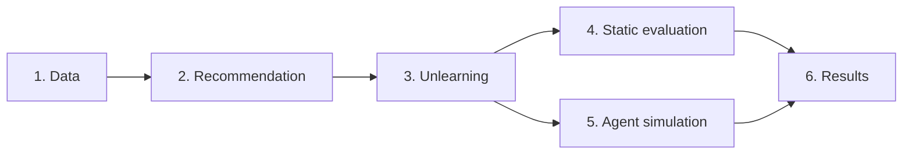

# AfterRec architecture overview

[简体中文](OVERVIEW.zh-CN.md) · [Documentation](../README.md) · [Project README](../../README.md)

AfterRec uses a modular, local-first design. A web interface and an experiment API coordinate the workflow. Each experiment module has a defined responsibility and can be extended independently.

## System flow

This is a **logical overview**. Model outputs from Original, fresh Retrain and Unlearned variants are compared by the evaluators. The web interface manages experiments and displays the resulting metrics and interaction traces.

## Main modules

| Module | Purpose |
| --- | --- |
| **Data management** | Import interactions and item metadata; manage splits and forget/retain requests. |
| **Recommendation** | Train and load models; provide scoring and Top-K recommendations. |
| **Unlearning** | Produce models after a forget request, including a fresh retraining baseline. |
| **Static evaluation** | Compare recommendation quality, forgetting behavior and efficiency using consistent settings. |
| **Agent simulation** | Run controlled multi-turn interactions, collect feedback and record exposed recommendations. |
| **Experiment platform** | Coordinate backend tasks, expose APIs, show results and replay trajectories. |

### How the modules connect

The data module supplies fixed inputs to recommendation training and unlearning. Recommendation models expose a shared inference interface. The unlearning module outputs model variants that static evaluation and agent simulation can both use. The agent runtime asks a model for recommendations, executes permitted user actions and records each step. The platform collects metric records and traces into an experiment report.

The implementation uses a **modular Python backend**, a **web frontend** and **local experiment artifacts**. Shared types and interfaces keep data, model and run identifiers consistent across modules.

## Evaluation boundaries

Technical unlearning and user-perceived exposure are reported separately. Comparisons use consistent data splits, item candidates and model settings. Agent sessions start from independent state, do not access future outcomes, and keep the recommendation model frozen unless an experiment explicitly specifies otherwise. Synthetic user actions remain labeled as simulated.

## Detailed documentation

Module design templates and interfaces are indexed in [docs/README.md](../README.md). The existing [shared contracts](../contracts/INTERFACES.md) define current cross-module types. See the [simulation protocol](../research/SIMULATION_PROTOCOL.md) for research constraints.

> **Development status:** The architecture describes the planned complete workflow. Individual modules and the web integration are still under development.
