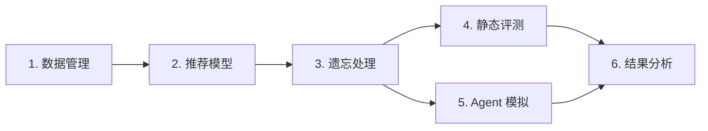

# AfterRec 整体架构

[English](OVERVIEW.md) · [文档目录](../README.md) · [项目首页](../../README.zh-CN.md)

AfterRec 采用本地优先的模块化设计。Web 页面与实验 API 负责组织任务，各实验模块通过统一接口协作，后续可以独立替换推荐模型、遗忘算法和 Agent 策略。

## 系统流程

这是**逻辑流程图**。Original、从头训练的 Retrain 和 Unlearned 模型会分别进入评测模块。Web 平台负责发起实验，并统一展示指标及多轮交互轨迹。

## 核心模块

| 模块 | 主要功能 |
| --- | --- |
| **数据管理** | 导入交互与商品信息，管理数据划分和 Forget/Retain 请求。 |
| **推荐模型** | 模型训练、保存、加载、打分和 Top-K 推荐。 |
| **遗忘处理** | 按遗忘请求生成模型，提供从头训练的 Retrain 对照。 |
| **静态评测** | 在统一设置下比较推荐质量、遗忘表现和运行效率。 |
| **Agent 模拟** | 驱动多轮用户行为，收集反馈、曝光列表和交互轨迹。 |
| **实验平台** | 负责后端任务调度、API、页面展示与轨迹回放。 |

### 模块如何协作

数据模块提供固定的训练和评测数据；推荐模型通过统一接口提供推荐结果。遗忘模块生成不同的模型版本，静态评测与 Agent 模拟分别对这些模型进行分析。Agent 每轮从模型获取推荐、执行合法动作并保存记录。平台汇总指标与轨迹，形成可查看的实验结果。

工程上采用**模块化 Python 后端、Web 前端和本地实验产物存储**。模块间统一数据、模型和任务标识，便于复现实验与后续扩展。

## 评测边界

技术遗忘与用户感知结果分别报告。模型对照使用一致的数据划分、候选商品和评测配置；Agent 实验保持独立会话状态，不接触未来结果，默认冻结推荐模型参数。所有合成用户行为必须明确标注为模拟数据。

## 详细设计

各模块的设计文档与接口模板见[文档目录](../README.md)，当前跨模块数据类型见[公共接口](../contracts/INTERFACES.md)，Agent 研究约束见[模拟协议](../research/SIMULATION_PROTOCOL.md)。

> **开发状态：** 这里描述的是完整目标架构，各模块与网页集成仍在逐步实现。
