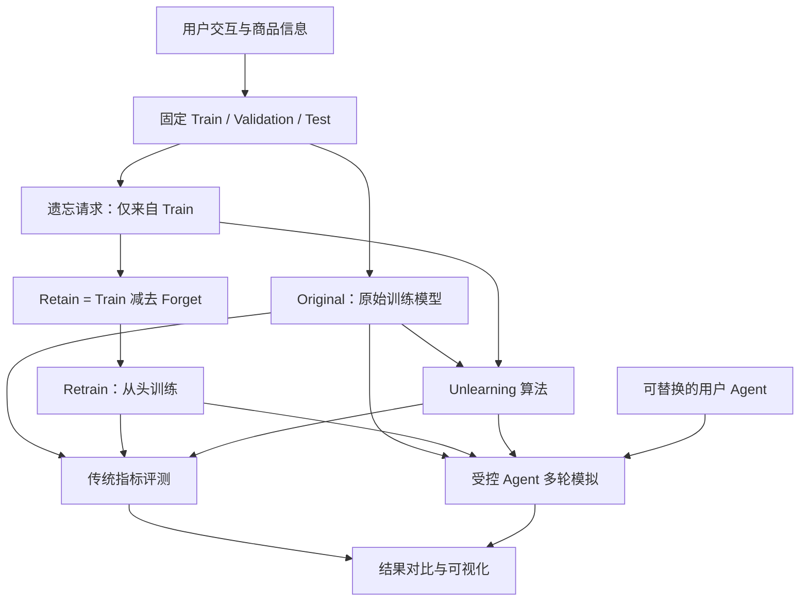

# AfterRec 整体架构设计

[English](OVERVIEW.md) · [项目首页](../../README.zh-CN.md) · [公共接口](../contracts/INTERFACES.md) · [Agent 模拟协议](../research/SIMULATION_PROTOCOL.md)

AfterRec 采用**本地优先的模块化架构**。Python 后端执行推荐、遗忘和用户模拟实验，Web 前端负责配置任务与查看结果。推荐模型、遗忘算法和 Agent 通过公共接口接入，便于后续替换和扩展。

本文描述的是**目标架构**。目前仓库已有基础工程骨架，完整实验闭环仍在开发中。

## 端到端实验流程



Original、Retrain 和 Unlearned 必须分别保存。Retrain 使用 Retain 集合重新初始化并训练，是衡量遗忘结果的重要参考；其他 Unlearning 算法按各自方法要求处理原始模型。

## 核心模块

| 模块 | 主要功能 | 对外接口 |
| --- | --- | --- |
| `datasets` | 导入交互和商品信息，管理数据版本、划分及用户/商品 ID | 数据集与数据划分记录 |
| `recsys` | 通过 RecBole 等适配器训练/加载模型，提供打分和 Top-K | 模型产物、推荐接口 |
| `unlearning` | 生成遗忘请求，执行 Retrain 与其他遗忘算法 | 接收模型与数据划分，输出新模型 |
| `evaluation` | 计算推荐效用、遗忘诊断及实验对比 | 使用统一协议生成指标记录 |
| `simulation` | 驱动 Agent 多轮交互、验证动作、记录曝光与反馈 | 推荐模型接口、可替换 Agent 策略 |
| `api` + `frontend` | 实验任务管理、推荐展示、指标对比和轨迹回放 | 使用公共 API，不包含算法核心逻辑 |

`core` 保存共享数据类型、校验与运行记录。MVP 阶段采用本地文件和模型 Checkpoint 管理实验产物。整体为**模块化单体架构**，不需要微服务部署，也能保持算法模块之间的边界。

## 两条评测主线

**技术遗忘评测：** 对 Original、Retrain、Unlearned 采用统一的用户、候选商品、ID 映射和过滤规则，比较推荐效果与遗忘表现。初期使用 Recall@K、NDCG@K；MIA、隐私指标和效率指标在评测协议完善后接入。

**用户感知评测：** Agent 接收用户画像、删除意图、当前推荐列表及已执行的历史行为，选择 `click`、`dislike`、`skip` 或 `exit`。运行器记录每轮曝光和反馈，通过会话状态影响后续推荐；交互过程中默认冻结推荐模型参数。

推荐中出现语义相关内容，**不能单独证明技术遗忘失败**。AfterRec 分开报告模型指标与用户曝光结果，再分析两者之间的差异。

## 实验约束

- **避免数据泄漏：** Forget 和 Retain 只划分原始训练集；验证/测试数据、未来行为和隐藏标签不能进入训练或 Agent 观察。
- **保证可比性：** 不同模型实验组重置 Agent 记忆与会话状态，保持候选集合及反馈机制一致。
- **支持复现：** 记录数据版本、随机种子、模型与 Prompt 版本、代码版本、指标及完整轨迹。
- **区分模拟与真实：** 合成轨迹始终标为 synthetic。评分/评论数据不能直接当作真实的多轮浏览日志；LLM Agent 还需通过人类数据或标注进行验证。

具体字段与方法见[公共接口规范](../contracts/INTERFACES.md)，模拟实验约束见[Agent 协议](../research/SIMULATION_PROTOCOL.md)。

## 代码结构

```text
backend/src/recforgetbench/
  core/          公共类型与校验
  datasets/      数据导入与划分
  recsys/        推荐模型适配
  unlearning/    遗忘算法与 Retrain
  evaluation/    静态指标
  simulation/    Agent 多轮运行框架
  api/           FastAPI 接口
frontend/        Web 前端（目前为离线原型）
docs/            架构、接口和科研协议
tests/           单元与集成测试
```

现有 Python 包名仍为 `recforgetbench`；项目对外名称统一使用 **AfterRec**。

## 实现进度

**已经具备：** API 健康检查与能力状态、基础数据校验、独立指标函数、最小 Agent 运行框架以及模拟数据交互原型。

**后续顺序：** 真实 RecBole 训练与 Top-K → Forget/Retain 和 Retrain → 静态指标对照 → 真实推荐模型上的 3–5 轮 Agent 交互。LLM Agent 校准、真人评测与新型用户感知指标属于后续科研扩展。

详细清单见[开发路线图](../ROADMAP.md)。
